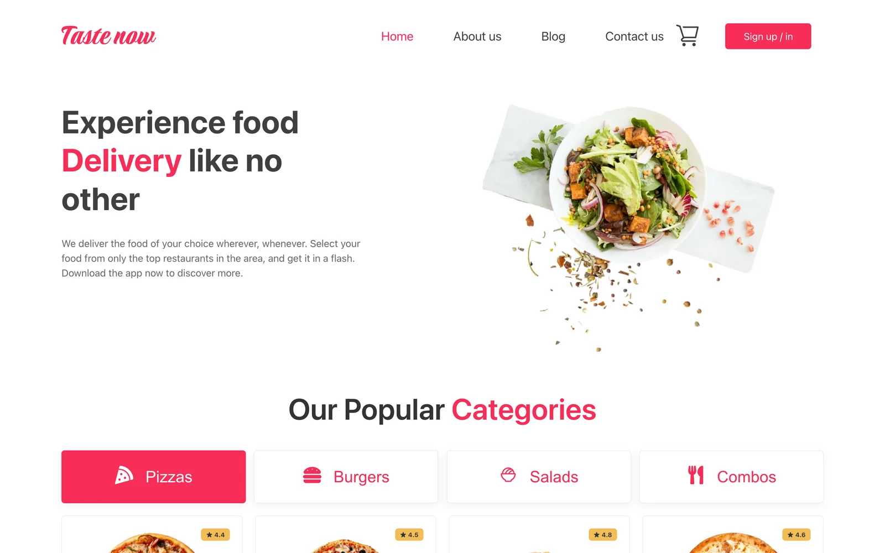
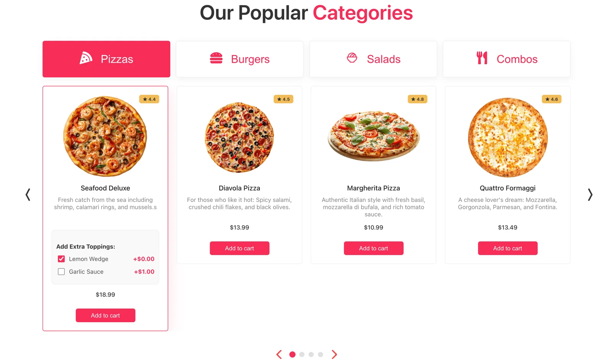
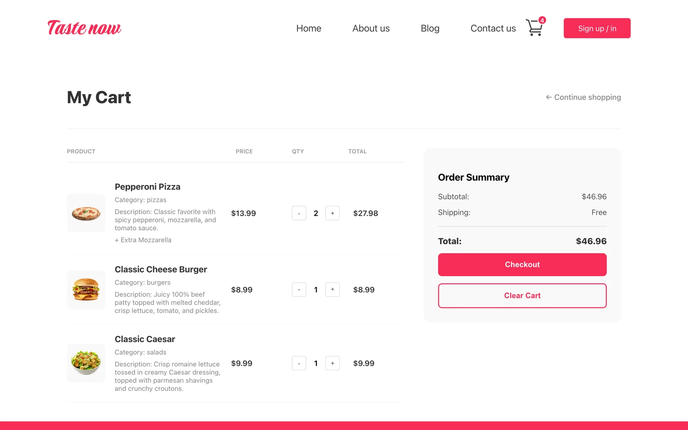
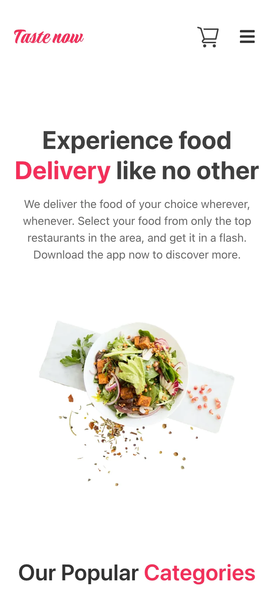
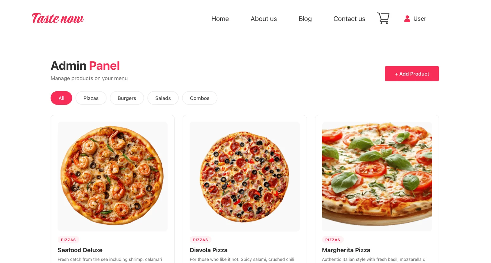

<div align="center">

# TasteNow — Food Delivery Web App

A responsive food delivery website built from a Figma UI kit with React 19 and Vite,
with a working cart, user accounts, order history and an admin panel powered by Firebase.

**[Live demo](https://taste-now-kappa.vercel.app)** · **[Figma design](https://www.figma.com/design/1hgPWOgSgkNTbOwHM7Ej2i/TasteNow---Food-Delivery-Web-and-Mobile-App---UI-Kit--Community-)**

[](https://github.com/Jendosek/taste_now/actions/workflows/ci.yml)


[](LICENSE)



</div>

## Screenshots

| Menu with toppings | Cart |
|:---:|:---:|
|  |  |
| **Mobile** | **Admin panel** |
|  |  |

## Features

- **Figma → React** — the web pages of the UI kit built as reusable React components, responsive from mobile to desktop with a dedicated mobile menu.
- **Menu by categories** — pizzas, burgers, salads and combos in Swiper sliders; extra toppings update the price live.
- **Cart** — quantity controls, the same dish with different toppings kept as separate lines, totals rounded to cents. Saved in the browser and synced to Firestore for signed-in users.
- **Accounts** — email/password sign-up and login (Firebase Auth) with unique usernames; the UI stays in sync with the real Firebase session.
- **Checkout & order history** — orders are stored in Firestore and listed in the user profile.
- **Admin panel** — create, edit and delete products or seed the catalog. The admin role lives in Firestore and is enforced by Security Rules, not just hidden in the UI.
- **Content pages** — blog with search and category filter, reviews with star rating, contact form with validation, help / privacy / terms pages and a custom 404.
- **SEO** — per-page titles, Open Graph link previews, `sitemap.xml` and `robots.txt`.

## Performance

Lighthouse, mobile (Moto G Power, Slow 4G):

| Performance | SEO | LCP | TBT | CLS |
|:---:|:---:|:---:|:---:|:---:|
| **95** | **100** | 2.5 s | 10 ms | 0 |

What made the difference:

- **Images −90%** (36 MB → 3.8 MB): product photos resized to their display size, other images converted to WebP.
- **Code splitting** — every page except Home is lazy-loaded; JavaScript on first load dropped from 517 KB to 240 KB (gzip).
- **Loading priorities** — the hero image is fetched with high priority, everything below the fold is lazy-loaded.
- **Fixed Figma export bloat** — 37 px social icons exported as SVGs with embedded 2048 px PNGs (441 KB) replaced with 7 KB of WebP.

## Tech stack

| Area | Tools |
|---|---|
| UI | React 19, React Router 7, Swiper, React Icons, plain CSS |
| State | Redux Toolkit (slices, async thunks, listener middleware for persistence) |
| Backend | Firebase Authentication, Cloud Firestore + Security Rules |
| Tooling | Vite 8, ESLint 10, Vitest + Testing Library |
| Hosting | Vercel |

## Getting started

**Requirements:** Node.js 20.19+ and a Firebase project (see [Firebase setup](#firebase-setup)).

```bash
git clone https://github.com/Jendosek/taste_now.git
cd taste_now
npm install
cp .env.example .env.local   # then fill in your Firebase web config
npm run dev                  # http://localhost:5173
```

| Script | What it does |
|---|---|
| `npm run dev` | Start the dev server |
| `npm run build` | Production build into `dist/` |
| `npm run preview` | Serve the production build locally |
| `npm run lint` | Run ESLint |
| `npm test` | Run unit and component tests once (`npm run test:watch` for watch mode) |

## Firebase setup

1. Create a Firebase project, enable **Authentication → Email/Password** and create a **Cloud Firestore** database.
2. Register a web app and copy its config into `.env.local` (keys are listed in [`.env.example`](.env.example)).
3. Publish the security rules from [`firestore.rules`](firestore.rules): paste them into *Firestore → Rules* in the console, or run `firebase deploy --only firestore:rules`.
4. Make yourself an admin: sign up in the app, then in Firestore create a document `admins/{your user UID}` (any field, e.g. `email`).
5. Fill the menu: open **Admin panel** and click **Initialize products from default catalog**.

| Collection | Contents | Access |
|---|---|---|
| `products` | Menu items | Public read, admin write |
| `users` / `usernames` | Profiles and reserved usernames | Owner only / availability check |
| `carts` | Saved cart per user | Owner only |
| `orders` | Placed orders | Owner read & create, admin manage |
| `reviews` | Customer reviews | Public read, validated create |
| `admins` | Admin user IDs | Managed in the console only |

## Project structure

```text
src/
├── components/     # Layout, header, footer, page title, scroll-to-top
├── features/       # Self-contained sections: menu slider, reviews, blog list, contact form…
├── screens/        # Pages: home, about, blog, contact, cart, profile, auth, admin, 404…
├── store/          # Redux store, slices and localStorage persistence middleware
├── hooks/          # Auth session listener, cart sync, logout, responsive helper
├── utils/          # User profile loading, admin check
├── assets/         # Images and JSON content (catalog, blog, contact cards)
└── firebase.js     # Firebase initialisation from env variables
```

## Deployment

The app is deployed on **Vercel**. [`vercel.json`](vercel.json) sets the Vite build and rewrites all routes to `index.html` so client-side routes work on refresh. Add the `VITE_FIREBASE_*` variables from `.env.example` in the Vercel project settings.

## Credits

- Design: [TasteNow — Food Delivery Web and Mobile App UI Kit](https://www.figma.com/design/1hgPWOgSgkNTbOwHM7Ej2i/TasteNow---Food-Delivery-Web-and-Mobile-App---UI-Kit--Community-) (Figma Community).
- Food photos and illustrations belong to their respective owners and are used for demonstration only.

## License

The source code is available under the [MIT License](LICENSE).
